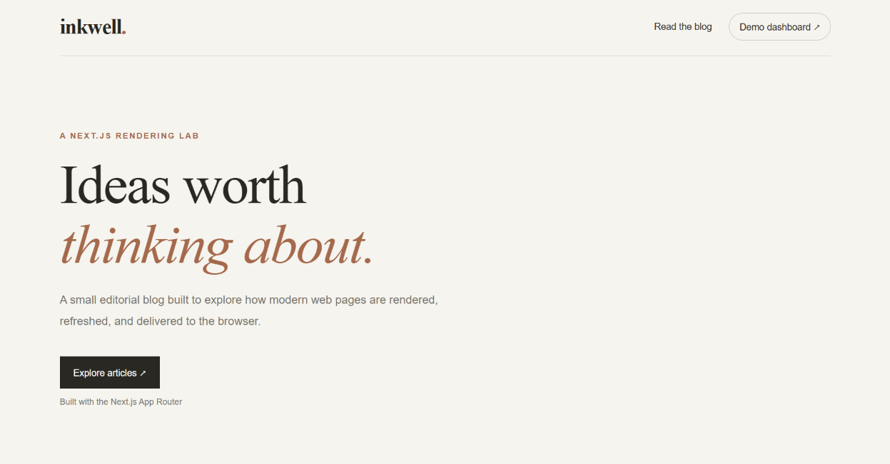
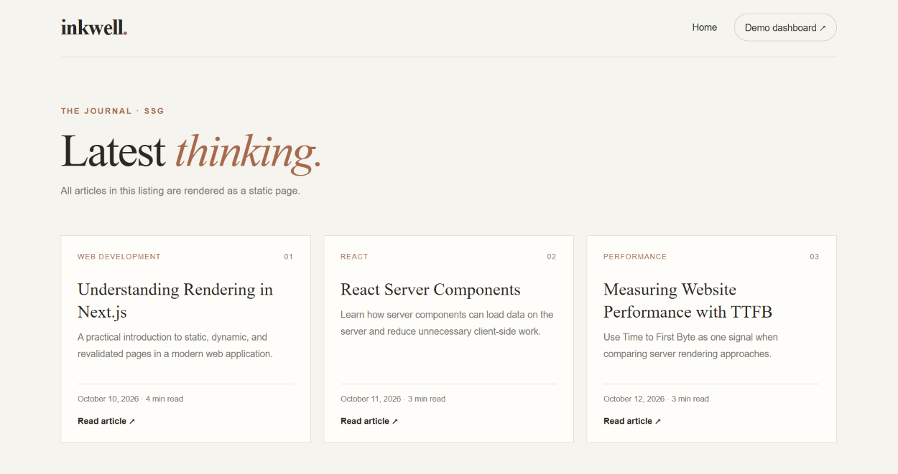
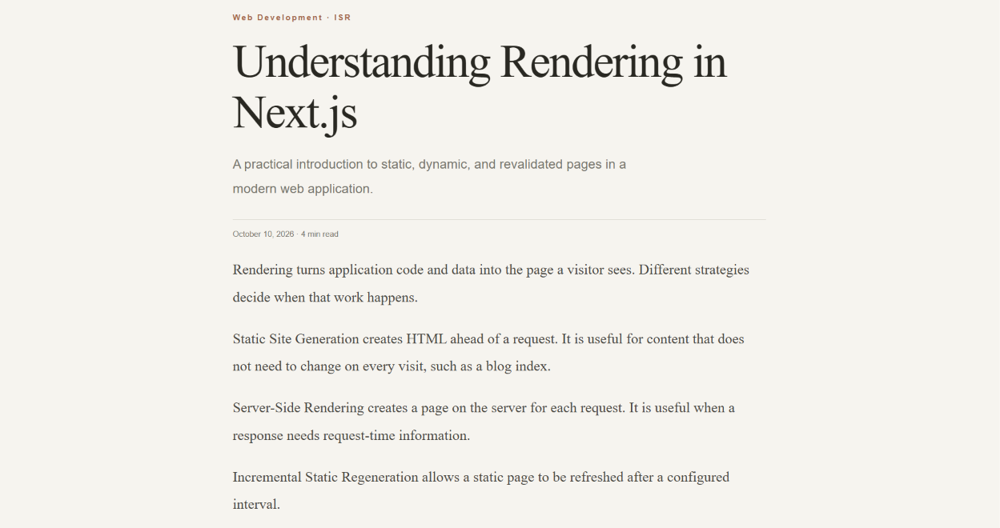
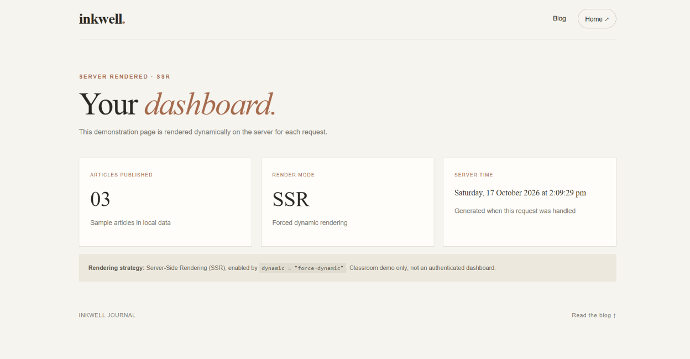

# Inkwell — A Next.js Blog

Inkwell is a modern, editorial-style blog built with Next.js and TypeScript. This project demonstrates different rendering strategies available in the Next.js App Router and compares their response times through local Time to First Byte (TTFB) measurements.

## Features

- Clean, responsive blog interface
- Blog listing with statically generated content
- Individual article pages using Incremental Static Regeneration (ISR)
- Dynamically rendered dashboard using Server-Side Rendering (SSR)
- Static route generation with `generateStaticParams()`
- Reusable article data and React Server Components
- Custom not-found page
- Local TTFB measurements for comparing rendering strategies

## Tech Stack

- Next.js 16
- React
- TypeScript
- CSS
- Node.js and npm

## Rendering Strategies

| Strategy | Route | Implementation |
|---|---|---|
| Static Site Generation (SSG) | `/blog` | Blog listing is generated as static HTML |
| Incremental Static Regeneration (ISR) | `/blog/[slug]` | Article pages are generated with a revalidation interval |
| Server-Side Rendering (SSR) | `/dashboard` | Dashboard is rendered dynamically for each request |

The article pages use `generateStaticParams()` to generate known article routes during the build. The dashboard uses dynamic rendering to demonstrate server-rendered content.

## TTFB Measurements

The following results were measured locally by making five requests to each route.

| Rendering strategy | Route | Average TTFB |
|---|---|---:|
| SSG | `/blog` | 5.63 ms |
| ISR | `/blog/nextjs-rendering` | 5.79 ms |
| SSR | `/dashboard` | 23.96 ms |

These measurements are specific to the local development environment and test conditions. They are illustrative results, not a universal performance benchmark. Actual response times may differ depending on the server, network, caching, and deployment environment.

## Screenshots

Screenshots of the running application are included below to demonstrate the homepage, blog listing, individual article page, and dashboard.

### Homepage


### Blog Listing — SSG


### Article Page — ISR


### Dashboard — SSR


## Getting Started

### Prerequisites

Install a supported version of Node.js and npm.

### Installation

### Installation

Clone the repository:

```bash
git clone https://github.com/juee04/nextjs-inkwell-blog.git
cd nextjs-inkwell-blog
```

Install dependencies:

```bash
npm install
```

Start the development server:

```bash
npm run dev
```

Open [http://localhost:3000](http://localhost:3000) in your browser.

### Production Build

Create an optimized production build:

```bash
npm run build
```

Start the production server:

```bash
npm run start
```

## Project Structure


## Project Structure

```text
nextjs-inkwell-blog/
├── app/
│   ├── blog/
│   │   ├── [slug]/
│   │   │   └── page.tsx
│   │   └── page.tsx
│   ├── dashboard/
│   │   └── page.tsx
│   ├── globals.css
│   ├── layout.tsx
│   ├── not-found.tsx
│   └── page.tsx
├── lib/
│   └── posts.ts
├── screenshots/
│   ├── homepage.png
│   ├── blog-list.png
│   ├── article-isr.png
│   └── dashboard-ssr.png
├── next.config.ts
├── package.json
├── package-lock.json
├── eslint.config.mjs
└── tsconfig.json
```

The exact files and folders may vary slightly with the project structure.

## Learning Outcomes

This project demonstrates how to implement and distinguish SSG, ISR, and SSR in Next.js, generate static routes, organize article data, build a multi-page interface, and measure local response times.

## Future Improvements

- Deploy the application to a hosting platform
- Improve accessibility and responsive behavior
- Add more articles and search functionality
- Repeat performance measurements in a deployed environment

---

**Author:** Juee Sanas

**Project:** Inkwell — Next.js Blog

**Purpose:** Web Technology learning project and portfolio demonstration